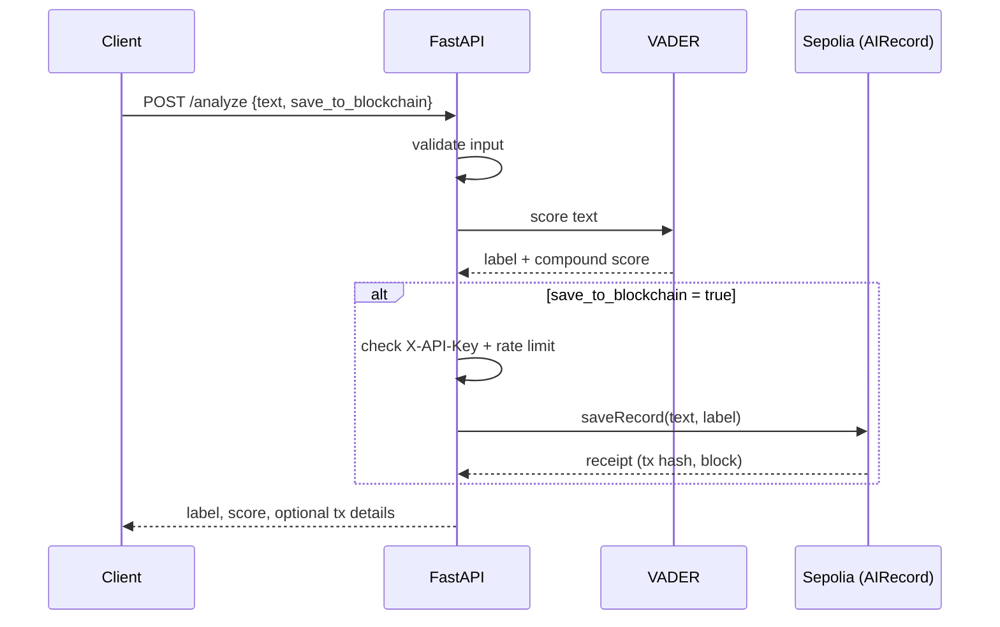

<div align="center">

# Sepolia Sentiment API

**Text sentiment analysis over REST, with optional tamper-evident records on the Ethereum Sepolia testnet.**

[](https://github.com/ShriyaP1966/sepolia-sentiment-api/actions/workflows/ci.yml)
[](LICENSE)
[](https://www.python.org/)
[](https://fastapi.tiangolo.com/)
[](contracts/AIRecord.sol)
[](https://sepolia.etherscan.io/address/0x39E7cccCA9A0AC85F19Bb1DE7F88D48bA7c5FF19)
[](Dockerfile)
[](https://github.com/astral-sh/ruff)
[](https://github.com/ShriyaP1966/sepolia-sentiment-api/commits/main)

</div>

> **Live demo:** _coming soon (deploying to Render)_

---

## What it does

Send some text, get back a sentiment label (`positive`, `negative` or `neutral`) and a score. Add `save_to_blockchain: true` and the result is also written to a smart contract on Sepolia, so anyone can verify it later on Etherscan.

```bash
curl -X POST http://127.0.0.1:8000/analyze \
  -H "Content-Type: application/json" \
  -d '{"text": "This is not good"}'
```

```json
{
  "text": "This is not good",
  "sentiment": "negative",
  "score": -0.3412,
  "blockchain": "not_requested",
  "contract_address": "0x39E7cccCA9A0AC85F19Bb1DE7F88D48bA7c5FF19"
}
```

## Highlights

- **Real NLP, not a keyword list.** [VADER](https://github.com/cjhutto/vaderSentiment) understands negation ("not good"), punctuation and intensity ("GREAT!!!").
- **On-chain proof.** Optional write to the `AIRecord` Solidity contract; the response includes the transaction hash, block number and an Etherscan link.
- **Safe to expose publicly.** Blockchain writes require an `X-API-Key` header, are rate limited per client, and use a nonce lock so concurrent requests cannot collide.
- **Starts anywhere.** The Sepolia connection is made on first use, so the API boots without credentials and `/health` never depends on the RPC.
- **Tested.** 40 pytest tests (web3 mocked, no wallet or network needed), ruff linting, and a GitHub Actions pipeline that also builds the Docker image.
- **Deploy-ready.** Dockerfile, health check, non-root container, and a one-click Render blueprint.

## How it works



## Quick start

```powershell
git clone https://github.com/ShriyaP1966/sepolia-sentiment-api.git
cd sepolia-sentiment-api
python -m venv venv
.\venv\Scripts\Activate.ps1
python -m pip install -r requirements.txt
python -m uvicorn app.main:app --reload
```

Open <http://127.0.0.1:8000/docs> for the interactive Swagger UI. Sentiment analysis works immediately with no configuration. To enable blockchain features, copy `.env.example` to `.env` and fill in the values below.

### Configuration

| Variable | Needed for | Description |
|---|---|---|
| `SEPOLIA_RPC_URL` | blockchain | Sepolia RPC endpoint (for example from Alchemy) |
| `SEPOLIA_PRIVATE_KEY` | blockchain writes | **Throwaway testnet wallet only**, never one with real funds |
| `API_KEY` | blockchain writes | Clients send it as the `X-API-Key` header. Empty disables writes |
| `CONTRACT_ADDRESS` | optional | Defaults to the deployed contract below |
| `WRITE_RATE_LIMIT`, `WRITE_RATE_WINDOW_SECONDS` | optional | Defaults to 5 writes per 60 seconds per client |

Never commit `.env`.

## API reference

| Method | Path | Description |
|---|---|---|
| `GET` | `/` | Greeting |
| `GET` | `/health` | Liveness probe (never calls the blockchain) |
| `POST` | `/analyze` | Analyze text, optionally save the result to Sepolia |
| `GET` | `/record` | Read the latest record stored in the contract |

### Saving to the blockchain

```bash
curl -X POST http://127.0.0.1:8000/analyze \
  -H "Content-Type: application/json" \
  -H "X-API-Key: $API_KEY" \
  -d '{"text": "This is an excellent result", "save_to_blockchain": true}'
```

The response then also contains `transaction_hash`, `block_number`, `transaction_status` and `etherscan_url`. This sends a real Sepolia transaction and spends test ETH.

### Status codes

| Status | Meaning |
|---|---|
| `200` | Success |
| `400` / `422` | Invalid input (empty or whitespace text, over 1,000 characters, wrong types, malformed JSON) |
| `401` | Missing or wrong `X-API-Key` |
| `402` | Wallet has no Sepolia ETH for gas |
| `429` | Write rate limit exceeded (see the `Retry-After` header) |
| `502` | RPC failure or reverted transaction |
| `503` | Blockchain not configured, or writes disabled |

## Smart contract

[`contracts/AIRecord.sol`](contracts/AIRecord.sol) stores **one** record (`latestRecord`). Each `saveRecord` call overwrites the previous one, and anyone can call it, so treat it as a testnet demo and not a data store.

Deployed on Sepolia at [`0x39E7cccCA9A0AC85F19Bb1DE7F88D48bA7c5FF19`](https://sepolia.etherscan.io/address/0x39E7cccCA9A0AC85F19Bb1DE7F88D48bA7c5FF19). The source was written to match the deployed contract's ABI and behavior; it has not been verified byte-for-byte against the deployed bytecode on Etherscan.

## Project structure

```text
app/
  main.py          FastAPI routes
  sentiment.py     VADER classifier
  chain.py         Lazy Sepolia client (read, write, nonce lock)
  config.py        Environment-based settings
  abi.py           Contract ABI
  ratelimit.py     In-memory sliding-window limiter
contracts/         Solidity source
scripts/           Manual helpers (wallet check, test write, read record)
tests/             pytest suite
Dockerfile         Container image
render.yaml        Render blueprint
```

## Development

```powershell
python -m pip install -r requirements-dev.txt
pytest
ruff check .
ruff format --check .
```

## Deployment

### Vercel

1. In Vercel choose **Add New → Project** and import this repository. Vercel detects the FastAPI app (`app/main.py`) automatically.
2. Under **Environment Variables** add `SEPOLIA_RPC_URL`, `SEPOLIA_PRIVATE_KEY` and `API_KEY`. Sentiment analysis works without them; only the blockchain features need them.
3. Deploy, then check `/health`.

On a serverless platform each instance has its own rate limiter and nonce lock, so limits are per instance, not global. A transaction wait can also exceed the function time limit on slower plans; if a write times out, check Etherscan before retrying.

### Render

Choose **New → Blueprint**, select this repository, and set the same three variables. The free tier sleeps when idle, so the first request after a pause is slow.

### Docker

```bash
docker build -t sepolia-sentiment-api .
docker run -p 8000:8000 --env-file .env sepolia-sentiment-api
```

The container runs a single worker because the rate limiter and nonce lock are per process.

## Limitations

- VADER is lexicon-based and can misjudge sarcasm or domain-specific language.
- The contract keeps only the latest record and has no access control.
- The rate limiter is in memory: it resets on restart and is not shared across instances.
- Testnet only. Do not point this at Ethereum mainnet.

## Author

Built by **Shriya Patil** ([@ShriyaP1966](https://github.com/ShriyaP1966)).

Released under the [MIT License](LICENSE). See the [CHANGELOG](CHANGELOG.md) for release notes.
